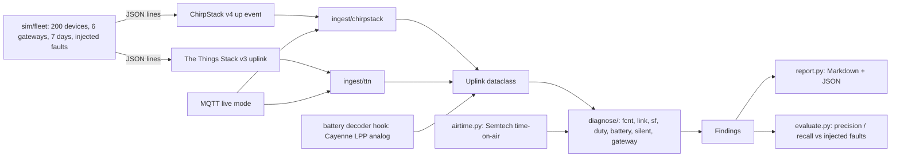

# lorawan-fleet-doctor

Thousands of battery sensors fail quietly. A device with a dying cell, a gateway that dropped off the
backhaul, or an ADR loop that slowly pushes a node to SF12 all look like "a few missing uplinks" until
someone drives out to the site. This tool reads the uplink events your network server already
produces and tells you, per device and per gateway, what is wrong and what to look at first.

It is small on purpose (pure Python, standard library only, about 1300 lines plus tests) so you can read all of
it and change the thresholds to fit your own network.

## What it checks

| Check | How it works | Example evidence |
|---|---|---|
| `fcnt_gaps` | Missed uplinks from frame-counter gaps; handles 16-bit and 32-bit rollover | `FCnt gaps: 86 of 335 expected uplinks missing (26%) over 7 d; loss grew from 8% to 37%` |
| `fcnt_reset` | Counter going backwards that is not a rollover = reboot or rejoin | `Frame counter went backwards 3x over 7 d` |
| `link_margin` | Median SNR above the demodulation floor of the current SF (SX127x table) | `Link margin +2.0 dB above the SF12 demodulation floor` |
| `link_drift` | RSSI/SNR, first vs last window (min of 24 h and a quarter of the data) | `RSSI drifted down 12.0 dB` |
| `sf_creep` | ADR pushing a device to slower data rates, with the airtime cost | `SF7 -> SF10: 57 ms -> 371 ms (x6.6)` |
| `duty_cycle` | Time on air per device (Semtech formula) vs the 1 % EU868 sub-band limit, peak sliding hour | `Airtime peaks at 1.63% of an hour (limit 1%)` |
| `battery` | Theil-Sen fit on daily medians of the decoded voltage, days until a cutoff | `Battery at 2.89 V falling 60 mV/day: about 6 days until 2.5 V` |
| `silent` | No uplink for more than k x the device's own interval | `No uplink for 84.9 h = 85x its usual interval of 60 min` |
| `gateway_outage` | Long silence on a gateway; counts the devices that normally reach it and how many were rerouted or lost | `heard nothing for 6.0 h ... 64 devices normally reach it: 48 rerouted, 16 not heard by any gateway` |

Every finding has the same shape: `{device|gateway, check, severity, evidence, suggestion}`.

## Architecture



## Quickstart

```bash
python -m venv .venv && . .venv/bin/activate     # Windows: .venv\Scripts\activate
pip install pytest paho-mqtt                      # paho-mqtt only needed for `listen`

python -m fleetdoctor simulate --days 7 --out events.jsonl --format=chirpstack   # or tts
python -m fleetdoctor diagnose events.jsonl --format=chirpstack \
       --report report.md --json report.json --truth events.jsonl.truth.json
python -m fleetdoctor listen --mqtt localhost --topic 'application/+/device/+/event/up'
python -m pytest -q
```

`simulate` also writes `events.jsonl.truth.json`, the list of faults it injected. `diagnose --truth` scores
the report against it. `--format auto` (default for `diagnose`) detects the server by the JSON shape.

Battery voltage is read through a pluggable decoder (`fleetdoctor.ingest.battery`). The default reads the Cayenne LPP analog
input on channel 1 (0.01 V steps). For other sensors register a function per DevEUI:

```python
from fleetdoctor.ingest import DecoderRegistry, load_file
reg = DecoderRegistry(per_device={"a1b2c3d4e5f60708": lambda data: data[2] / 10})
uplinks = load_file("events.jsonl", "chirpstack", reg)
```

## Input formats

Field names follow the public documentation; I could not machine-read the Things Stack page when I wrote this (it renders client-side), so
the TTS fixture is built from the documented `UplinkMessage` fields and should be checked against a real message from your stack.

- ChirpStack v4 `up` event: `deviceInfo.devEui`, `fCnt`, `fPort`, `data` (base64), `rxInfo[].gatewayId/rssi/snr`,
  `txInfo.modulation.lora.spreadingFactor/bandwidth/codeRate` (`CR_4_5`). Docs: <https://www.chirpstack.io/docs/chirpstack/integrations/events.html>
  (the example there omits `fCnt`; it is part of the `UplinkEvent` message).
- The Things Stack v3 uplink: `end_device_ids.dev_eui`, `uplink_message.f_cnt`, `f_port`, `frm_payload`,
  `rx_metadata[].gateway_ids.gateway_id/rssi/snr`, `settings.data_rate.lora.spreading_factor/bandwidth/coding_rate`.
  Docs: <https://www.thethingsindustries.com/docs/the-things-stack/concepts/data-formats/> and
  <https://www.thethingsindustries.com/docs/api/reference/grpc/>.

Both servers omit zero-valued fields, so a missing `f_cnt`/`fCnt` is read as 0.

## Airtime check

`diagnose/airtime.py` implements the time-on-air formula from the Semtech SX1276 datasheet / AN1200.13 (preamble +
payload symbols, explicit header, CRC, low-data-rate optimisation when the symbol time is above 16 ms).
Verified against the published LoRaWAN airtime calculator at <https://www.thethingsnetwork.org/airtime-calculator>
(EU868, 10 B application payload = 23 B on air, CR 4/5, 125 kHz): SF7 61.7 ms, SF8 113.2 ms, SF9 205.8 ms,
SF10 370.7 ms, SF11 823.3 ms, SF12 1.483 s. All six are asserted in `tests/test_airtime.py`.

## Sample report (simulated run, seed 7)

```
# LoRaWAN fleet report

49189 uplinks from 200 devices via 6 gateways, 2026-03-02T00:00 to 2026-03-08T23:59 UTC.

**9 critical, 7 warnings.** battery 3, duty_cycle 1, fcnt_gaps 4, fcnt_reset 1, gateway_outage 1, link_drift 2, link_margin 1, sf_creep 2, silent 1

## Top problems

- [CRITICAL] gateway_outage `9a7e000000000003` - Gateway heard nothing for 6.0 h (2026-03-06 09:58 -> 2026-03-06 16:00 UTC) while its usual rate is one uplink per 42 s; 64 devices normally reach it: 48 rerouted via another gateway, 16 not heard by any gateway during the outage
- [CRITICAL] silent `d3b0000000000064` - No uplink for 84.9 h = 85x its usual interval of 60 min (last seen 2026-03-05 11:03 UTC, last FCnt 896, battery 3.54 V)
- [CRITICAL] battery `d3b00000000000a0` - Battery at 2.89 V falling 60 mV/day: about 6 days until 2.5 V
- [CRITICAL] duty_cycle `d3b000000000001c` - Airtime peaks at 1.63% of an hour (limit 1%), average 1.53% over 7 d: 2.79 s per uplink (SF12, 61 B) every 3.0 min
- [CRITICAL] fcnt_gaps `d3b000000000002f` - FCnt gaps: 86 of 335 expected uplinks missing (26%) over 7 d; loss grew from 8% to 37% (first vs second half)
- [CRITICAL] fcnt_reset `d3b000000000007e` - Frame counter went backwards 3x over 7 d (device reboot or rejoin)
- [CRITICAL] link_drift `d3b0000000000054` - RSSI drifted down 12.0 dB (SNR 11.8 dB lower) between the first and last window of the data
- [CRITICAL] sf_creep `d3b0000000000054` - Spreading factor crept SF7 -> SF10: time on air per uplink 57 ms -> 371 ms (x6.6) ...
- [WARNING] link_margin `d3b0000000000003` - Link margin +2.0 dB above the SF12 demodulation floor (median SNR -18.0 dB, last window); ADR normally keeps ~10 dB
  ...

## Gateways

| Gateway | Uplinks heard | Devices heard | Regular devices | Median RSSI | Median SNR | Outages |
|---|---:|---:|---:|---:|---:|---:|
| `9a7e000000000001` | 11411 | 58 | 58 | -116.0 | 1.5 | 0 |
| `9a7e000000000003` | 14290 | 64 | 64 | -118.0 | -0.6 | 1 |
| ... |
```

The full report has a suggestion line per finding; this excerpt is shortened.

## Measured precision and recall

The simulator injects 16 (subject, check) faults: 3 dying batteries, 4 devices with growing packet loss, 2 SF creeps after an
obstruction (one of them with a 12 dB RSSI drop), 1 SF12 device whose link degrades, 1 silent device, 1 rebooting device
(3 FCnt resets), 1 airtime hog (48 B at SF12 every 3 min) and 1 six-hour gateway outage. Some devices also use 16-bit frame counters
that roll over during the run, to make sure that is not reported as loss.

| Run | Precision | Recall |
|---|---|---|
| Default seed 7, ChirpStack and TTS formats | 16/16 = 100 % | 16/16 = 100 % |
| 20 different seeds (320 injected faults) | 320/324 = 98.8 % | 320/320 = 100 % |

The four false findings across 20 seeds are all `silent` on a high-loss device whose last six uplinks happened to be lost, and
those devices really were broken. Reproduce: `python -m fleetdoctor diagnose events.jsonl --truth events.jsonl.truth.json`.

## Honest limits

- **The fleet is simulated.** The simulator and the thresholds were written by the same person, so 100 % on this data
  says the checks work as designed, not that they will be this clean on a real network. Not run against a live network server
  or a real MQTT broker; `listen` is a thin wrapper that has only been exercised through the parser.
- **Thresholds need tuning per deployment** (`diagnose/common.py`, `Config`): loss %, margin dB, battery cutoff voltage and chemistry,
  duty-cycle limit (1 % is the EU868 default sub-band), silent-after-k intervals. They assume uplinks every 30-60 minutes.
- Battery forecasting assumes a roughly linear decline; real cells have knees, and temperature moves voltage. Treat days-to-empty as triage, not a promise.
- Frame-counter analysis assumes uplinks arrive roughly in order, and cannot tell a reset from a rollover when a 16-bit counter resets close to its limit.
- The gateway check uses reception timestamps only; it cannot tell a dead gateway from a dead backhaul.
- Region assumptions: LoRa only, SF7-SF12, EU868 duty cycle. No FSK or LR-FHSS.
- No affiliation with, or endorsement by, any project or vendor named here. ChirpStack, The Things Stack and Semtech are referenced as technologies.

## Next steps

- Grafana panel / Prometheus exporter for the findings so they sit next to existing dashboards.
- Webhook output that opens a ticket per finding, de-duplicated by subject and check.
- Downlink fixes: re-trigger ADR, push a longer reporting interval to an airtime hog, request a status uplink from silent devices.
- Learn per-fleet baselines (per device class, per hour of day) instead of fixed thresholds.
- Replay recorded real traffic and label it to replace the simulator as the benchmark.

## Layout

```
fleetdoctor/ingest/    ChirpStack + TTS parsers, battery decoder hook (Cayenne LPP)
fleetdoctor/sim/       fleet simulator with injected faults, JSON renderers
fleetdoctor/diagnose/  airtime + one module per check
fleetdoctor/report.py  Markdown / JSON report;  evaluate.py  precision/recall;  cli.py
tests/                 parsers, airtime, FCnt, checks, end to end
```

MIT licensed.
